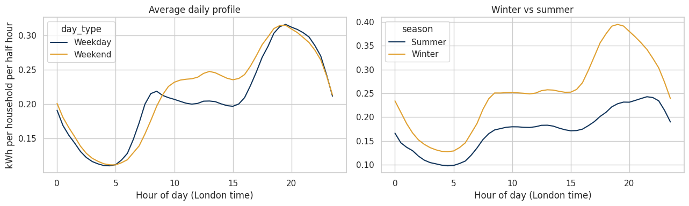
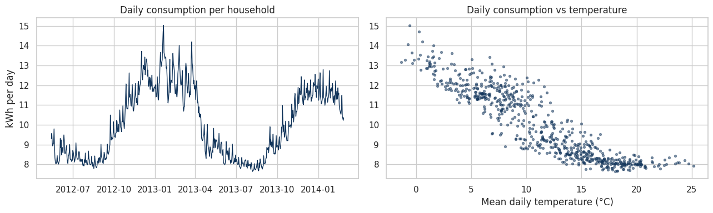
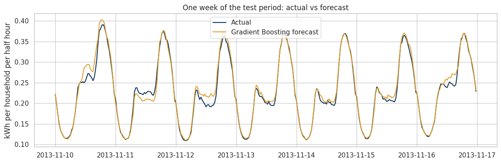
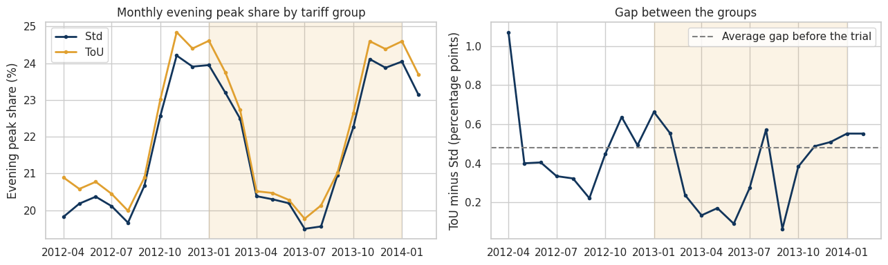

# London Household Electricity Demand: Big Data Forecasting with PySpark

Day-ahead forecasting of household electricity demand and an evaluation of time-of-use pricing, using **167.8 million half-hourly smart meter readings** from 5,561 London households.

## Questions

1. **Can we forecast household electricity demand a day ahead?** Energy suppliers solve this problem every day to plan how much electricity to buy.
2. **What drives demand?** Time of day, season, temperature, and holidays.
3. **Did time-of-use pricing change behaviour?** About 1 in 5 households in the trial paid prices that varied by time of day during 2013. Did they shift consumption away from the evening peak?

## Data

[Smart meters in London](https://www.kaggle.com/datasets/jeanmidev/smart-meters-in-london) (Kaggle): half-hourly readings from November 2011 to February 2014, with household tariff groups, hourly weather (Dark Sky observations), and UK bank holidays.

| Stage | Households | Readings |
|---|---|---|
| Raw files (all 112 of the original dataset) | 5,566 | 167,817,021 |
| After cleaning | 5,561 | 167,811,461 |
| Analysis window (May 2012 to Feb 2014) | 5,561 | 160,388,865 |

Five registered households were excluded because all of their readings are `Null`.

## Approach

**1. Processing with PySpark.** All raw files are loaded with Spark on a single machine and reduced to compact tables before any modelling. Data quality checks:
- energy values stored as text padded with spaces, with missing values written as the word `Null` (5,560 readings, and 5 households with no valid reading at all)
- duplicate and negative readings (none found)
- a **bank holidays file with day-first dates**: 8 of 25 dates were stored as `YYYY-DD-MM`, so a naive parser places Easter Monday 2012 in September. The dates were corrected and verified against the holiday names.
- **clock changes**: both meter and weather data turned out to be recorded in GMT all year (48 half hours and 24 hours on the clock-change days), so they align with each other. The data stays indexed in GMT, so no reading is lost or doubled; London local time is used only to label each reading's clock hour, weekday, month, and holiday, because people live by the clock on the wall.

**2. Choosing the right target.** Meters were installed gradually, so total consumption grows simply because more households report. The target is therefore **average consumption per reporting household**, on complete days with enough meters reporting.

**3. Forecasting.** Each day at midnight, the model forecasts all 48 half hours of the next day using calendar features, temperature, and demand from yesterday and last week. Evaluation uses a time-based split (final four months as the test set), a rolling-origin check over four separate months, and a test without temperature to measure how much observed weather helps.

**4. Time-of-use evaluation.** A difference-in-differences design compares how each household's evening peak share (16:00 to 20:00, London time) changed from 2012 to 2013, with one value per household (equivalent to clustering by household) and a month-by-month check of the parallel-trends assumption.

## Results

### What drives demand

Demand peaks around 19:00 to 20:00, and winter evenings are much higher than summer evenings. Daily consumption is strongly linked to temperature (correlation -0.91).

### Why the target matters

With the same calendar features, a model explains **5%** of the variation in a single household's readings but **91%** of the variation in average demand. Individual behaviour is noisy; averaging over thousands of households reveals the shared pattern.

### Day-ahead forecast (test period: final four months)

| Model | MAE (kWh) | MAPE | R² |
|---|---|---|---|
| Baseline: same time yesterday | 0.0130 | 5.5% | 0.930 |
| Baseline: same time last week | 0.0126 | 5.4% | 0.944 |
| Linear Regression | 0.0101 | 4.4% | 0.965 |
| **Gradient Boosting** | **0.0077** | **3.3%** | **0.980** |

MAE is the mean absolute error, in kWh per household per half hour, averaged over all 5,952 half hours of the test period. The Gradient Boosting MAE of 0.0077 kWh means that, on average, the forecast for one household's consumption in a half hour is off by about **8 Wh**, against average demand of 236 Wh per half hour. It is an average error per household per half hour, not a daily error or a total.

- Gradient Boosting cuts the error of the best baseline by **39%**.
- Retrained month by month, it scores **3.1% ± 0.1** and beats the baseline in all four months.
- Yesterday's demand, last week's demand, and time of day drive the forecast. The hardest days are Christmas, Boxing Day, and 1 to 2 January.

**How much does observed temperature help?** The model uses observed temperature, while a real forecast would only have a weather forecast. Retraining without temperature on exactly the same test set shows the advantage is small:

| Gradient Boosting | MAE (kWh) | MAPE | R² |
|---|---|---|---|
| With observed temperature | 0.0077 | 3.25% | 0.980 |
| Without temperature | 0.0086 | 3.68% | 0.976 |

A model using a real weather forecast would land between the two.

### Time-of-use pricing

- ToU households reduced their evening peak share by **0.14 percentage points** more than standard households (95% confidence interval: -0.30 to +0.02). The interval includes zero, so the difference is **not statistically significant** at the 5% level (p = 0.088).
- The comparison covers 5,327 households (1,089 ToU) with at least 60 days of readings in both years.
- The gap between the groups was roughly stable before the trial, narrowed in spring and early summer 2013, and returned to its usual level afterwards.
- Conclusion: at most a **small** shift away from the evening peak. The trial did not produce a large change in when households used electricity.

## Limitations

- Observed temperature stands in for a weather forecast; the test without temperature shows this advantage is small.
- The training data contains only one Christmas period, so festive-season behaviour is hard to learn.
- Price signals sent to ToU households are not in the dataset, so responses to individual high-price days cannot be measured.

## Tools

PySpark, pandas, scikit-learn, SciPy, Matplotlib, Seaborn

## How to Run

The dataset is too large for a typical laptop, so the notebook is designed for Kaggle:

1. Create a new Kaggle notebook and import `electricity_demand_forecasting.ipynb`.
2. Add the [Smart meters in London](https://www.kaggle.com/datasets/jeanmidev/smart-meters-in-london) dataset.
3. Turn on Internet in the notebook settings (needed to install PySpark if missing), then select **Run All**.
